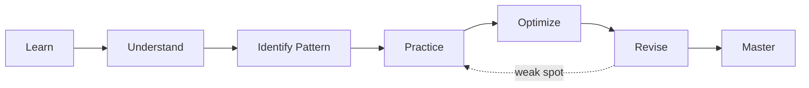

<div align="center">


</div>

---

## Overview

A topic-wise repository for learning **Data Structures and Algorithms** through clear notes, reusable patterns, and clean **Python** solutions to LeetCode problems.
The goal is strong algorithmic thinking, independent problem solving, and a reusable reference for software engineering interviews.

### Key Features

- Clear explanations of DSA concepts
- Reusable algorithmic patterns and code templates
- LeetCode solutions in Python with brute-force and optimized approaches
- Step-by-step dry runs, edge cases, and common mistakes
- Time and space complexity for every solution
- Per-topic progress trackers, weekly reviews, and revision notes
- Solutions that run and self-check automatically through GitHub Actions

---

## Table of Contents

- [Current Focus](#current-focus)
- [Roadmap and Progress](#roadmap-and-progress)
- [Learning Methodology](#learning-methodology)
- [Solution Format](#solution-format)
- [Repository Structure](#repository-structure)
- [Running the Solutions](#running-the-solutions)
- [LeetCode Stats](#leetcode-stats)
- [Tech Stack](#tech-stack)
- [Learning Resources](#learning-resources)
- [Repository Philosophy](#repository-philosophy)

---

## Current Focus

| | |
|---|---|
| **Topic** | Binary Search |
| **Period** | November 2026 |
| **Status** | In Progress |
| **Next up** | Two Pointers |

**[View Binary Search notes and solutions →](./Binary-Search)*

---

## Roadmap and Progress

Tick a topic only after understanding the concept, solving related problems, and implementing the key patterns independently. Link each topic to its folder once it exists.

<details open>
<summary><b>1. Foundations</b></summary>

- [ ] Programming Fundamentals
- [ ] Python Fundamentals for DSA
- [ ] Time and Space Complexity
- [ ] Big O Notation and Asymptotic Analysis
- [ ] Recursion Fundamentals
- [ ] Mathematics for DSA

</details>

<details open>
<summary><b>2. Data Structures</b></summary>

- [ ] Arrays
- [ ] Strings
- [ ] Linked Lists (Singly and Doubly)
- [ ] Stacks
- [ ] Queues and Circular Queues
- [ ] Hash Tables and Hash Maps
- [ ] Sets
- [ ] Trees and Binary Trees
- [ ] Binary Search Trees
- [ ] Heaps and Priority Queues
- [ ] Tries
- [ ] Graphs

</details>

<details open>
<summary><b>3. Searching and Sorting</b></summary>

- [ ] Linear Search
- [x] [Binary Search](./Binary-Search)
- [ ] Binary Search on Answer
- [ ] Bubble Sort
- [ ] Selection Sort
- [ ] Insertion Sort
- [ ] Merge Sort
- [ ] Quick Sort
- [ ] Counting Sort
- [ ] Heap Sort

</details>

<details open>
<summary><b>4. Problem-Solving Patterns</b></summary>

- [ ] Two Pointers
- [ ] Sliding Window
- [ ] Fast and Slow Pointers
- [ ] Prefix Sum
- [ ] Difference Array
- [ ] Hashing
- [ ] Monotonic Stack and Queue
- [ ] Intervals
- [ ] Cyclic Sort
- [ ] Divide and Conquer

</details>

<details open>
<summary><b>5. Algorithmic Techniques</b></summary>

- [ ] Greedy Algorithms
- [ ] Backtracking
- [ ] Breadth-First Search (BFS)
- [ ] Depth-First Search (DFS)
- [ ] Topological Sorting
- [ ] Shortest Path Algorithms
- [ ] Minimum Spanning Tree
- [ ] Dynamic Programming
- [ ] Bit Manipulation
- [ ] Disjoint Set Union (DSU)

</details>

<details open>
<summary><b>6. Advanced Topics</b></summary>

- [ ] Advanced Dynamic Programming
- [ ] Segment Trees
- [ ] Fenwick Trees (Binary Indexed Trees)
- [ ] Strongly Connected Components
- [ ] Network Flow Fundamentals
- [ ] String Matching Algorithms

</details>

<details>
<summary><b>7. Interview Preparation (practice tracks)</b></summary>

- [ ] Arrays and Strings
- [ ] Searching and Sorting
- [ ] Linked Lists
- [ ] Stacks and Queues
- [ ] Trees and BSTs
- [ ] Graphs
- [ ] Dynamic Programming
- [ ] Mixed Problem Sets
- [ ] Timed Coding Practice
- [ ] Mock Technical Interviews

</details>

---

## Learning Methodology



A problem counts as mastered when I can:

- [ ] Explain it in my own words
- [ ] Identify the right algorithmic pattern
- [ ] Build a solution independently and explain why it works
- [ ] Write the Python code without copying
- [ ] Analyze time and space complexity
- [ ] Handle edge cases and solve related variations
- [ ] Explain the solution in an interview

---

## Solution Format

<details>
<summary><b>Every problem follows the same structure</b></summary>

| Section | What it covers |
|---|---|
| Problem Information | Title, number, difficulty, link |
| Problem Statement | Restatement, constraints, examples |
| Understanding | Observations and key insights |
| Pattern | The DSA pattern and why it fits |
| Brute Force | Initial approach and its limits |
| Optimized Approach | Improved solution and intuition |
| Python Solution | Clean, commented implementation |
| Dry Run | Step-by-step execution on an example |
| Complexity | Time and space |
| Edge Cases | Important test cases |
| Common Mistakes | Pitfalls to avoid |
| Follow-ups | Variations and related questions |
| Key Takeaways | Lessons learned |

</details>

---

## Repository Structure

```text
.
├── README.md
├── LICENSE
├── .gitignore
├── .github/workflows/ci.yml        # Runs every solution as a self-check
├── templates/
│   ├── PROBLEM_TEMPLATE.md
│   └── TOPIC_README_TEMPLATE.md
├── Binary-Search/
│   ├── README.md                   # Notes, patterns, tracker, problem table
│   ├── 704_binary_search.py
│   └── 35_search_insert_position.py
└── Two-Pointers/                   # Next topic
```

Each topic folder has its own README with concept notes, a problems table, a progress tracker, and a weekly review.

---

## Running the Solutions

Every solution file contains its own test cases, so there is nothing to install.

```bash
python Binary-Search/704_binary_search.py
```

No output means all checks passed. GitHub Actions runs every file on each push.

---

## LeetCode Stats

<div align="center">

<a href="https://leetcode.com/u/SNOZGle7Id/">
  
</a>

[View my LeetCode profile →](https://leetcode.com/u/SNOZGle7Id/)

</div>


## Tech Stack

| Technology | Purpose |
|---|---|
| Python 3 | Primary language |
| LeetCode | Coding practice |
| Git and GitHub | Version control and hosting |
| GitHub Actions | Automatic solution checks |
| Markdown | Technical documentation |

---

## Learning Resources

[LeetCode](https://leetcode.com/) · [GeeksforGeeks](https://www.geeksforgeeks.org/) · [Programiz](https://www.programiz.com/) · [VisuAlgo](https://visualgo.net/) · [CP-Algorithms](https://cp-algorithms.com/) · [Python Docs](https://docs.python.org/3/)

---

## Repository Philosophy

This repository exists to build a strong foundation in problem solving through consistent practice and detailed documentation.

The focus is on understanding *why* an algorithm works, spotting reusable patterns, weighing optimizations, and being able to solve unfamiliar problems independently.

<div align="center">

**Learn. Analyze. Implement. Optimize.**


</div>
